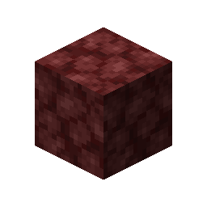
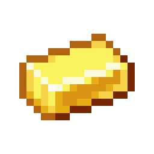
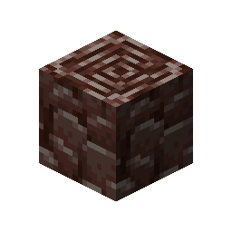

# Ancient Debris

This recipe produces **Ancient Debris** by combining ingredients in a Basin with a Mechanical Press.

## Ingredients

| Input | Amount |
|---|---:|
|  Netherrack | 16 |
|  Gold Ingot | 4 |
|  Blaze Powder | 4 |
|  Lava | 150 mB |

## Output

| Output | Amount |
|---|---:|
|  Ancient Debris | 1 |

## Processing Information

- **Machine:** Mechanical Press and Basin
- **Input:** 16 × Netherrack
- **Input:** 4 × Gold Ingot
- **Input:** 4 × Blaze Powder
- **Fluid input:** 150 mB × Lava
- **Output:** 1 × Ancient Debris
- **Heat requirement:** Superheated
- **Processing time:** 200 ticks (10 seconds)
