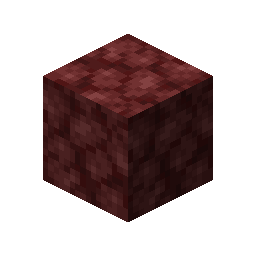
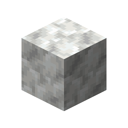
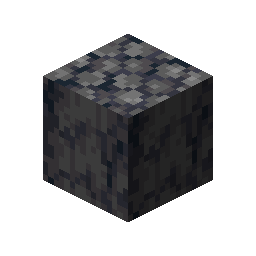

# Basalt

This recipe produces **Basalt** by combining ingredients in a Basin with a Mechanical Press.

## Ingredients

| Input | Amount |
|---|---:|
|  Netherrack | 4 |
|  Calcite | 2 |
|  Lava | 100 mB |

## Output

| Output | Amount |
|---|---:|
|  Basalt | 1 |

## Processing Information

- **Machine:** Mechanical Press and Basin
- **Input:** 4 × Netherrack
- **Input:** 2 × Calcite
- **Fluid input:** 100 mB × Lava
- **Output:** 1 × Basalt
