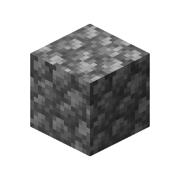
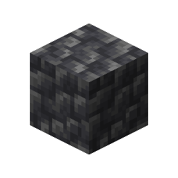

# Cobbled Deepslate

This recipe produces **Cobbled Deepslate** by combining ingredients in a Basin with a Mechanical Press.

## Ingredients

| Input | Amount |
|---|---:|
|  Cobblestone | 4 |

## Output

| Output | Amount |
|---|---:|
|  Cobbled Deepslate | 1 |

## Processing Information

- **Machine:** Mechanical Press and Basin
- **Input:** 4 × Cobblestone
- **Output:** 1 × Cobbled Deepslate
