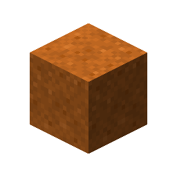
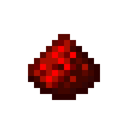
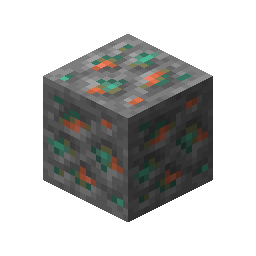

# Copper Ore

This recipe produces **Copper Ore** by combining ingredients in a Basin with a Mechanical Press.

## Ingredients

| Input | Amount |
|---|---:|
| Tag: `forge:cobblestone` | 1 |
|  Red Sand | 2 |
|  Redstone | 2 |

## Output

| Output | Amount |
|---|---:|
|  Copper Ore | 1 |

## Processing Information

- **Machine:** Mechanical Press and Basin
- **Input:** 1 × Tag: `forge:cobblestone`
- **Input:** 2 × Red Sand
- **Input:** 2 × Redstone
- **Output:** 1 × Copper Ore
- **Heat requirement:** Heated
- **Processing time:** 100 ticks (5 seconds)
