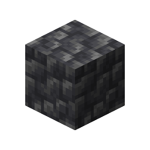
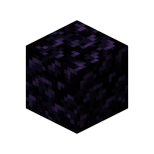
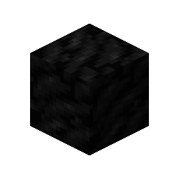
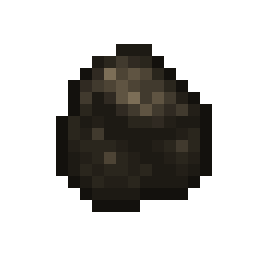
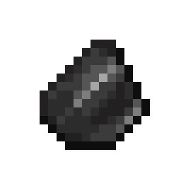
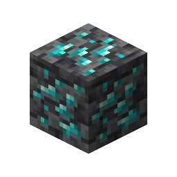

# Deepslate Diamond Ore

This recipe produces **Deepslate Diamond Ore** by combining ingredients in a Basin with a Mechanical Press.

## Ingredients

| Input | Amount |
|---|---:|
|  Cobbled Deepslate | 16 |
|  Diamond | 2 |
|  Obsidian | 4 |
|  Coal Block | 4 |
|  Charcoal | 4 |
|  Flint | 4 |

## Output

| Output | Amount |
|---|---:|
|  Deepslate Diamond Ore | 1 |

## Processing Information

- **Machine:** Mechanical Press and Basin
- **Input:** 16 × Cobbled Deepslate
- **Input:** 2 × Diamond
- **Input:** 4 × Obsidian
- **Input:** 4 × Coal Block
- **Input:** 4 × Charcoal
- **Input:** 4 × Flint
- **Output:** 1 × Deepslate Diamond Ore
- **Heat requirement:** Superheated
- **Processing time:** 200 ticks (10 seconds)
