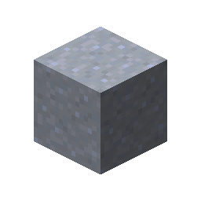
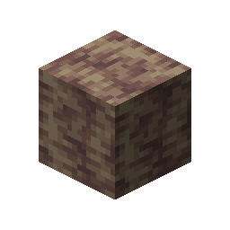

# Dripstone Block

This recipe produces **Dripstone Block** by combining ingredients in a Basin with a Mechanical Press.

## Ingredients

| Input | Amount |
|---|---:|
|  Clay | 1 |

## Output

| Output | Amount |
|---|---:|
|  Dripstone Block | 1 |

## Processing Information

- **Machine:** Mechanical Press and Basin
- **Input:** 1 × Clay
- **Output:** 1 × Dripstone Block
