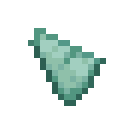
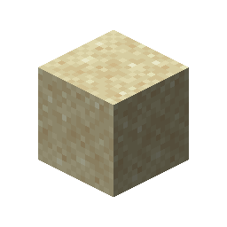
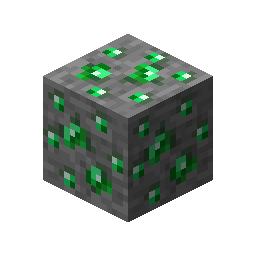

# Emerald Ore

This recipe produces **Emerald Ore** by combining ingredients in a Basin with a Mechanical Press.

## Ingredients

| Input | Amount |
|---|---:|
|  Prismarine Shard | 2 |
|  Amethyst Cluster | 2 |
|  Diamond | 1 |
|  Sand | 1 |
| Tag: `forge:cobblestone` | 1 |
|  Lava | 100 mB |

## Output

| Output | Amount |
|---|---:|
|  Emerald Ore | 1 |

## Processing Information

- **Machine:** Mechanical Press and Basin
- **Input:** 2 × Prismarine Shard
- **Input:** 2 × Amethyst Cluster
- **Input:** 1 × Diamond
- **Input:** 1 × Sand
- **Input:** 1 × Tag: `forge:cobblestone`
- **Fluid input:** 100 mB × Lava
- **Output:** 1 × Emerald Ore
- **Heat requirement:** Heated
- **Processing time:** 200 ticks (10 seconds)
