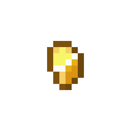
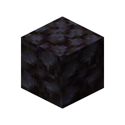
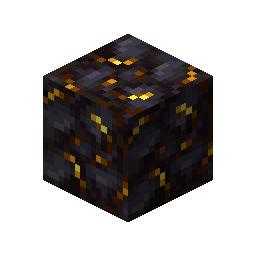

# Gilded Blackstone

This recipe produces **Gilded Blackstone** by combining ingredients in a Basin with a Mechanical Press.

## Ingredients

| Input | Amount |
|---|---:|
|  Gold Nugget | 14 |
|  Blackstone | 1 |

## Output

| Output | Amount |
|---|---:|
|  Gilded Blackstone | 1 |

## Processing Information

- **Machine:** Mechanical Press and Basin
- **Input:** 14 × Gold Nugget
- **Input:** 1 × Blackstone
- **Output:** 1 × Gilded Blackstone
- **Processing time:** 100 ticks (5 seconds)
