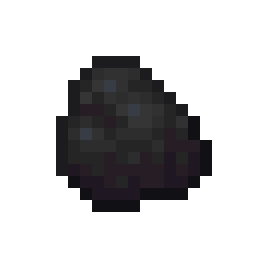
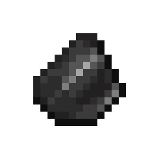
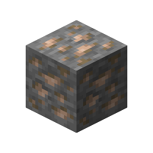

# Iron Ore

This recipe produces **Iron Ore** by combining ingredients in a Basin with a Mechanical Press.

## Ingredients

| Input | Amount |
|---|---:|
| Tag: `forge:cobblestone` | 1 |
|  Coal | 2 |
|  Flint | 2 |

## Output

| Output | Amount |
|---|---:|
|  Iron Ore | 1 |

## Processing Information

- **Machine:** Mechanical Press and Basin
- **Input:** 1 × Tag: `forge:cobblestone`
- **Input:** 2 × Coal
- **Input:** 2 × Flint
- **Output:** 1 × Iron Ore
- **Heat requirement:** Heated
- **Processing time:** 100 ticks (5 seconds)
