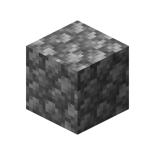
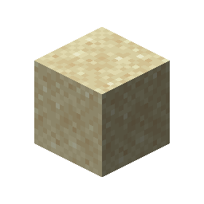
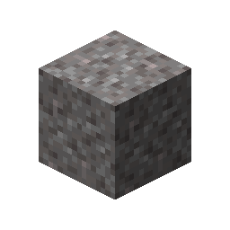
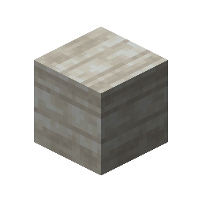

# Limestone

This recipe produces **Limestone** by combining ingredients in a Basin with a Mechanical Press.

## Ingredients

| Input | Amount |
|---|---:|
|  Cobblestone | 4 |
|  Sand | 2 |
|  Gravel | 1 |

## Output

| Output | Amount |
|---|---:|
|  Limestone | 1 |

## Processing Information

- **Machine:** Mechanical Press and Basin
- **Input:** 4 × Cobblestone
- **Input:** 2 × Sand
- **Input:** 1 × Gravel
- **Output:** 1 × Limestone
- **Processing time:** 100 ticks (5 seconds)
