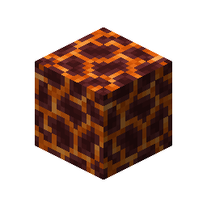

# Magma Block

This recipe produces **Magma Block** by combining ingredients in a Basin with a Mechanical Press.

## Ingredients

| Input | Amount |
|---|---:|
|  Lava | 250 mB |

## Output

| Output | Amount |
|---|---:|
|  Magma Block | 1 |

## Processing Information

- **Machine:** Mechanical Press and Basin
- **Fluid input:** 250 mB × Lava
- **Output:** 1 × Magma Block
