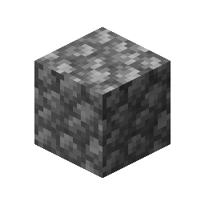
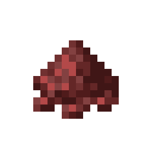
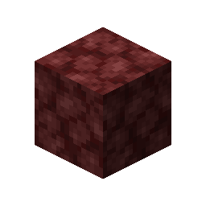

# Netherrack

This recipe produces **Netherrack** by combining ingredients in a Basin with a Mechanical Press.

## Ingredients

| Input | Amount |
|---|---:|
|  Cobblestone | 1 |
|  Cinder Flour | 1 |
|  Lava | 25 mB |

## Output

| Output | Amount |
|---|---:|
|  Netherrack | 1 |

## Processing Information

- **Machine:** Mechanical Press and Basin
- **Input:** 1 × Cobblestone
- **Input:** 1 × Cinder Flour
- **Fluid input:** 25 mB × Lava
- **Output:** 1 × Netherrack
