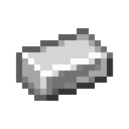
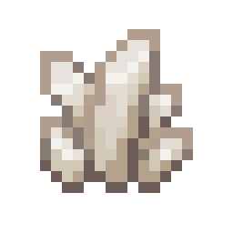
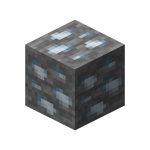

# Silver Ore

This recipe produces **Silver Ore** by combining ingredients in a Basin with a Mechanical Press.

## Ingredients

| Input | Amount |
|---|---:|
| Tag: `forge:cobblestone` | 1 |
|  Iron Ingot | 2 |
|  Quartz | 2 |

## Output

| Output | Amount |
|---|---:|
|  Silver Ore | 1 |

## Processing Information

- **Machine:** Mechanical Press and Basin
- **Input:** 1 × Tag: `forge:cobblestone`
- **Input:** 2 × Iron Ingot
- **Input:** 2 × Quartz
- **Output:** 1 × Silver Ore
- **Heat requirement:** Heated
- **Processing time:** 100 ticks (5 seconds)
