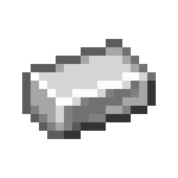
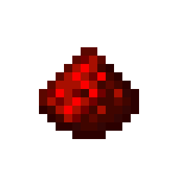
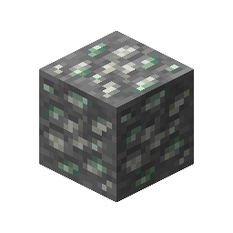

# Zinc Ore

This recipe produces **Zinc Ore** by combining ingredients in a Basin with a Mechanical Press.

## Ingredients

| Input | Amount |
|---|---:|
| Tag: `forge:stone` | 1 |
|  Iron Ingot | 2 |
|  Redstone | 2 |

## Output

| Output | Amount |
|---|---:|
|  Zinc Ore | 1 |

## Processing Information

- **Machine:** Mechanical Press and Basin
- **Input:** 1 × Tag: `forge:stone`
- **Input:** 2 × Iron Ingot
- **Input:** 2 × Redstone
- **Output:** 1 × Zinc Ore
- **Heat requirement:** Heated
- **Processing time:** 100 ticks (5 seconds)
